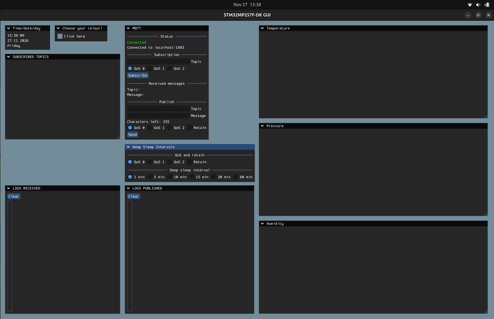
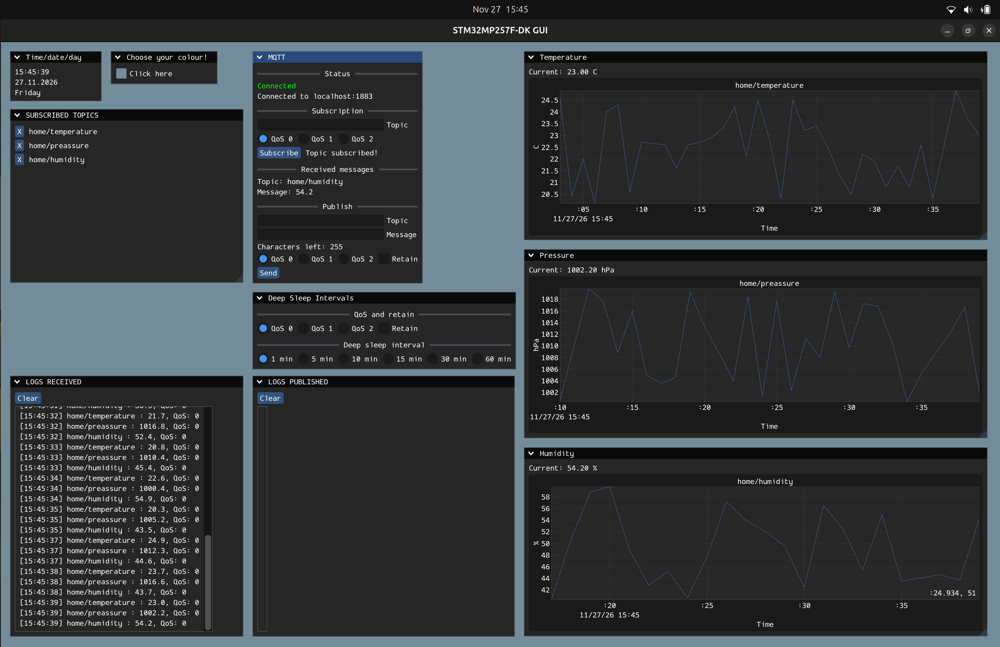

# STM32MP257F GUI

ImGui desktop app for the STM32MP257F-DK board: an MQTT panel for subscribing and publishing, message logs, plots (ImPlot), and deep sleep interval control for the sensor devices.

It connects to a local Mosquitto broker on `localhost:1883`.

Dear ImGui and ImPlot are licensed under the MIT license (see `external/imgui/LICENSE.txt` and `external/ImPlot/LICENSE`); this project is MIT licensed as well (see `LICENSE`).
